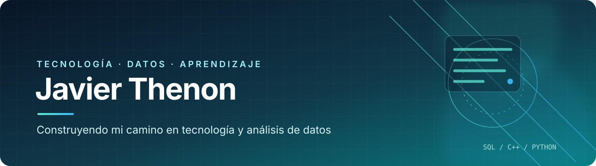

<!-- Banner personalizado del perfil -->

  

  

   

  
  
  

---

## 👋 Sobre mí

Soy **Técnico en Computación** y cuento con formación técnica en informática y programación. Durante la secundaria tuve contacto con distintos lenguajes y tecnologías; actualmente estoy retomando esos conocimientos de manera progresiva, con práctica y proyectos.

Mi experiencia en **atención al cliente, soporte operativo y tareas administrativas** me permitió desarrollar habilidades de comunicación, seguimiento, organización y resolución de problemas. Estoy complementando esa experiencia con formación técnica para ampliar mi perfil profesional.

- 🔎 Me interesa el análisis y la organización de datos.
- 🗃️ Estoy reforzando SQL y los fundamentos de bases de datos.
- 💻 Estoy recuperando la lógica de programación paso a paso.
- 🧪 Me interesa practicar con SQL, Python, C++ y Java.
- 🚀 Mi objetivo es crear proyectos prácticos y documentar lo que voy aprendiendo.

## 🎓 Formación académica

**Técnico en Computación**  
Escuela Técnica Nº 35 D.E.18 Ing. Eduardo Latzina

Formación técnica escolar con contenidos de informática, programación y bases de datos. Durante esta etapa tuve acercamiento a SQL, Java, Python, C++ y otros temas relacionados con computación. Actualmente estoy repasando esos contenidos para recuperar práctica y afianzar conceptos.

## 🧭 Mi camino de aprendizaje

| Tecnología | Mi recorrido |
|:--|:--|
|  | Formación previa y curso completado · Actualmente practicando |
|  | Formación previa · Próximo paso para retomar desde las bases |
|  | Formación previa · Próximo paso: lógica y fundamentos |
|  | Formación previa · Para repasar más adelante |
|  | Aprendiendo control de versiones y portfolio |

## 🛠️ Tecnologías y herramientas

Los lenguajes indicados forman parte de mi formación previa; estoy retomándolos gradualmente y no los presento como conocimientos avanzados o de dominio profesional.

## 📚 Cursos y certificaciones

**Aprende SQL — AprendeSQL.dev**

Certificado de finalización emitido el 6 de noviembre de 2026.

- 29 lecciones, 112 ejercicios y 7 exámenes completados.
- Consultas y filtros: `SELECT`, `WHERE`, `LIKE`, `IN`, `ORDER BY`.
- Uniones y valores nulos: `INNER JOIN`, `LEFT JOIN`, `NULL`.
- Agregación: `COUNT`, `SUM`, `GROUP BY`, `HAVING`.
- Manipulación y estructura de datos: `INSERT`, `UPDATE`, `DELETE`, `CREATE`, claves foráneas e índices.
- Consultas avanzadas: subconsultas, `UNION`, CTE y funciones de ventana como `OVER` y `ROW_NUMBER`.
- Introducción al ecosistema: SQLite, MySQL, Node.js y NoSQL.

## 📌 Proyectos

Estoy preparando mis primeros proyectos prácticos. Quiero que cada repositorio tenga ejemplos claros, instrucciones para ejecutarlos y una explicación de lo aprendido.

  

## 🌱 Objetivo

Seguir aprendiendo, practicar de forma constante y transformar cada tema estudiado en algo concreto que pueda compartir y mejorar.

  **Gracias por visitar mi perfil. ¡Esto recién empieza!**

   

  

